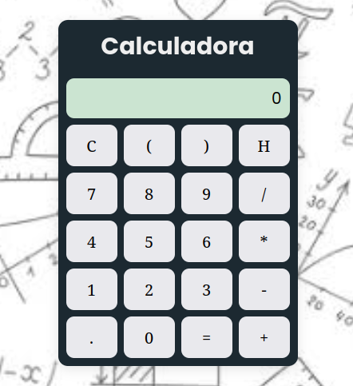

# 🧮 Calculadora Geométrica

## 🖌️ Design da Calculadora

## 💻 Sobre o Projeto
Esta é uma calculadora funcional desenvolvida para aplicar conceitos de manipulação de DOM com JavaScript puro (Vanilla JS), estilização avançada com CSS3 utilizando fontes geométricas circulares e design responsivo.

## 🚀 Funcionalidades
- [x] Operações básicas de matemática (Soma, Subtração, Multiplicação e Divisão).
- [x] Tratamento de erros para expressões matemáticas inválidas.
- [x] Botão de reset rápido.
- [x] Interface limpa e adaptada para dispositivos móveis.

## 🛠️ Tecnologias Utilizadas
As seguintes ferramentas foram usadas na construção do projeto:
- HTML5
- CSS3 (Fonte Poppins / Montserrat)
- JavaScript (Funções de escopo e `eval()`)

## 🔧 Como Rodar o Projeto
1. Clone este repositório: `git clone https://github.com`
2. Abra o arquivo `index.html` diretamente no seu navegador.

